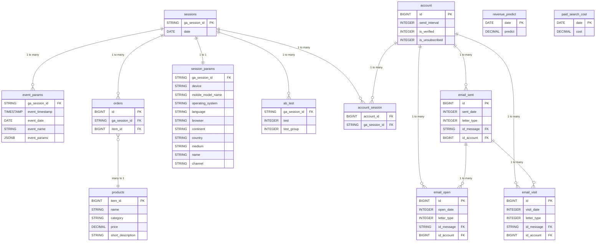

# 🗄🖧 SQL Projects

> [← Back to Portfolio](../README.md)

---

## Project 1: Web Analytics SQL Playground
*Tech:* PostgreSQL 17, Spring Boot 3.3, Liquibase, Docker, DataFaker

A hands-on SQL practice project built around simulated web analytics data — user sessions, events, A/B tests, email funnels, and orders. The full environment spins up in one command via Docker Compose and auto-generates realistic data on first run, so you can start writing queries immediately.

> The database is synthetic. It is populated with random data by DataFaker on every run, and the data is different each time. This project is a practice ground for writing SQL queries, not a real analysis with business conclusions — the generated numbers carry no business meaning.

### Database Schema

13 tables and their relationships (1:1, 1:M, M:N).

[Table descriptions and relationships](https://github.com/ArtemMakovskyy/sql-extra/blob/master/docs/database-schema.md)

- **Goal:** Demonstrate practical SQL skills across 13 normalized tables and 22 query files covering the full spectrum from basic JOINs to advanced window functions and CTEs.
- **Highlights:**
  - Designed a 13-table schema with 1:1, 1:M, and M:N relationships modeling real-world web analytics (sessions → events → orders, email sent → open → visit funnel).
  - Wrote 22 SQL files covering `JOIN`, `CASE WHEN`, `UNION`, subqueries, window functions (`ROW_NUMBER`, `LAG`, `RANK`), CTEs, VIEWs, and temp tables.
  - Built a full REST API (CRUD) for all entities using Spring Boot + JPA + MapStruct.
  - Used Liquibase for 13 versioned DDL migrations and DataFaker for generating 2000+ sessions, A/B test groups, email campaigns, and order histories.
- **Repo:** [GitHub](https://github.com/ArtemMakovskyy/sql-extra)

### Quick Access to SQL Queries

All query files live in the [`sql/`](https://github.com/ArtemMakovskyy/sql-extra/tree/master/sql) folder of the repo — direct links below.

**Learning queries (01–08)** — progression from basic constructs to more complex:

- [`01-basic.sql`](https://github.com/ArtemMakovskyy/sql-extra/blob/master/sql/01-basic.sql) — basic SELECT, JOIN, aggregation (`JOIN`, `GROUP BY`, `HAVING`, `COUNT`, `LIMIT`)
- [`02-case-when.sql`](https://github.com/ArtemMakovskyy/sql-extra/blob/master/sql/02-case-when.sql) — CASE WHEN conditions (`CASE`, `WHEN`, `THEN`, `ELSE`, `END`, conditional aggregation)
- [`03-union.sql`](https://github.com/ArtemMakovskyy/sql-extra/blob/master/sql/03-union.sql) — UNION / UNION ALL (`UNION ALL`, combining results from different queries)
- [`04_1-subquery_select.sql`](https://github.com/ArtemMakovskyy/sql-extra/blob/master/sql/04_1-subquery_select.sql) — subquery in SELECT (scalar subqueries)
- [`04_2-subquery_from.sql`](https://github.com/ArtemMakovskyy/sql-extra/blob/master/sql/04_2-subquery_from.sql) — subquery in FROM (derived tables, subqueries as source)
- [`04_3-subquery_where.sql`](https://github.com/ArtemMakovskyy/sql-extra/blob/master/sql/04_3-subquery_where.sql) — subquery in WHERE (`IN`, `EXISTS`, comparison with subquery)
- [`04_4-subquery_having.sql`](https://github.com/ArtemMakovskyy/sql-extra/blob/master/sql/04_4-subquery_having.sql) — subquery in HAVING (filtering groups by subquery result)
- [`04_5-subquery_join.sql`](https://github.com/ArtemMakovskyy/sql-extra/blob/master/sql/04_5-subquery_join.sql) — subquery in JOIN (joining with subquery result)
- [`05-data.sql`](https://github.com/ArtemMakovskyy/sql-extra/blob/master/sql/05-data.sql) — working with dates (`EXTRACT`, `+ interval`, `BETWEEN`, `DATE_TRUNC`)
- [`06-window-functions.sql`](https://github.com/ArtemMakovskyy/sql-extra/blob/master/sql/06-window-functions.sql) — window functions (`ROW_NUMBER()`, `RANK()`, `SUM() OVER`, `PARTITION BY`)
- [`06_0-window-functions-overview.sql`](https://github.com/ArtemMakovskyy/sql-extra/blob/master/sql/06_0-window-functions-overview.sql) — window functions overview (`ROW_NUMBER`, `RANK`, `DENSE_RANK`, `LAG`, `LEAD`)
- [`07-cte.sql`](https://github.com/ArtemMakovskyy/sql-extra/blob/master/sql/07-cte.sql) — common table expressions (`WITH`, recursive and non-recursive CTE)
- [`08_1-view.sql`](https://github.com/ArtemMakovskyy/sql-extra/blob/master/sql/08_1-view.sql) — views (`CREATE OR REPLACE VIEW`, `WITH` in VIEW)
- [`08_2-temp.sql`](https://github.com/ArtemMakovskyy/sql-extra/blob/master/sql/08_2-temp.sql) — temporary tables (`CREATE TEMP TABLE`, `DROP TABLE`)

**Analytical queries** — real-world web analytics scenarios:

- [`analytics.sql`](https://github.com/ArtemMakovskyy/sql-extra/blob/master/sql/analytics.sql) — sessions by device type, country, browser, channel
- [`email-funnel.sql`](https://github.com/ArtemMakovskyy/sql-extra/blob/master/sql/email-funnel.sql) — email funnel per account: sent → opened → clicked
- [`orders.sql`](https://github.com/ArtemMakovskyy/sql-extra/blob/master/sql/orders.sql) — orders count by product, revenue by product, orders by session
- [`products.sql`](https://github.com/ArtemMakovskyy/sql-extra/blob/master/sql/products.sql) — all products, filter by category, price range, top expensive
- [`sessions.sql`](https://github.com/ArtemMakovskyy/sql-extra/blob/master/sql/sessions.sql) — all sessions, filter by date, join with `session_params`

**Other:**

- [`09-ab.sql`](https://github.com/ArtemMakovskyy/sql-extra/blob/master/sql/09-ab.sql) — A/B testing analysis: sessions, events, orders, new accounts by test groups
- [`extra.sql`](https://github.com/ArtemMakovskyy/sql-extra/blob/master/sql/extra.sql) — combined query joining all 13 tables: account-centric SELECT with CTEs aggregating 1:M relationships, plus marketing/finance tables joined by session date
- [`temp.sql`](https://github.com/ArtemMakovskyy/sql-extra/blob/master/sql/temp.sql) — email activity (sent/open/visit) joined to session dates

---
